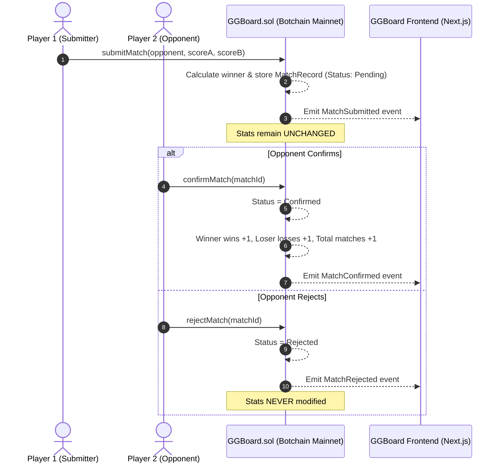
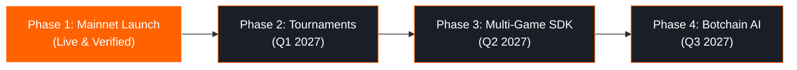

# GGBOARD WHITEPAPER
### Decentralized Peer-Verified Competitive Gaming Scoreboard on Botchain

**Version:** 1.1.0 (Mainnet Edition)  
**Network:** Botchain Mainnet (Chain ID: 677)  
**Native Currency:** BOT (Total Supply: 150,000,000 BOT)  
**RPC Endpoint:** [https://rpc.botchain.ai](https://rpc.botchain.ai)  
**Smart Contract:** `0x5e1ae0a3D053755BB203894dC6C97B951254a7A0`  
**Explorer:** [https://scan.botchain.ai/address/0x5e1ae0a3D053755BB203894dC6C97B951254a7A0](https://scan.botchain.ai/address/0x5e1ae0a3D053755BB203894dC6C97B951254a7A0#code)  
**Author / Team:** GGBoard Core Protocol  

---

## 1. Executive Summary

Competitive gaming records today are fragmented, vulnerable to centralized manipulation, and siloed within proprietary platforms. When a tournament platform shuts down or a centralized database is wiped, a gamer's hard-earned record vanishes.

**GGBoard** is a decentralized, zero-backend Web3 application that permanently anchors competitive gaming profiles, match records, and public leaderboards directly on-chain on **Botchain Mainnet**. Powered by a single, gas-optimized Solidity smart contract, GGBoard introduces an **Anti-Cheat Peer-Verification Protocol**: match submissions remain in a pending state until cryptographically authenticated by the opponent from their own wallet.

With zero databases, zero third-party cloud backends, and no speculative token barriers, GGBoard delivers pure on-chain utility for competitive players.

---

## 2. Problem Statement

### 2.1 Centralized Vulnerability & Ephemeral Records
Traditional esports platforms store player match histories in centralized SQL/NoSQL databases. These records can be altered by administrators, lost due to server deprecation, or forged.

### 2.2 Unilateral Fraud & Disputed Matches
In peer-to-peer 1v1 competitive play, false reporting is rampant. Players routinely report inflated scores or claim victories their opponents never conceded. Without trustless confirmation, disputes require manual admin arbitration, causing friction and distrust.

### 2.3 Web3 Bloat & Unnecessary Tokenization
Many Web3 gaming applications force unnecessary ERC-20 tokens, speculative NFTs, or pay-to-play gating onto users, alienating traditional gamers and creating regulatory complexity.

---

## 3. The GGBoard Solution

GGBoard solves these challenges through three core design principles:

```
┌─────────────────────────────────────────────────────────────────┐
│                       GGBOARD PROTOCOL                          │
├─────────────────────┬─────────────────────┬─────────────────────┤
│   100% ON-CHAIN     │   PEER-VERIFIED     │   ZERO-BACKEND      │
│   All data lives    │   Opponent wallet   │   No database,      │
│   in Solidity state │   must sign outcome │   no server, pure   │
│   on Botchain (677) │   before rank updates│   trustless dApp   │
└─────────────────────┴─────────────────────┴─────────────────────┘
```

1. **Self-Sovereign Gamer Identity**: Gamers claim a unique, permanent on-chain tag tied directly to their wallet address.
2. **Cryptographic Peer-Verification**: No match result counts toward player statistics, win rates, or leaderboard standing until the opponent confirms it on-chain.
3. **Immutable Public Leaderboard**: Standings are calculated dynamically via on-chain contract logic, sorted by confirmed wins with transparent tie-breaker algorithms.

---

## 4. System Architecture & Smart Contract Design

GGBoard is built as a unified single-contract system (`GGBoard.sol`) interacting with a single-page reactive frontend.



### 4.1 Data Structures

```solidity
enum MatchStatus {
    Pending,    // 0: Awaiting opponent signature
    Confirmed,  // 1: Verified; stats updated
    Rejected    // 2: Disputed; no stats altered
}

struct Profile {
    string username;
    uint32 totalWins;
    uint32 totalLosses;
    uint32 totalMatches;
    bool isRegistered;
    uint256 registeredAt;
}

struct MatchRecord {
    uint256 matchId;
    address playerOne;
    address playerTwo;
    uint32 playerOneScore;
    uint32 playerTwoScore;
    address winner;
    MatchStatus status;
    uint256 timestamp;
}
```

### 4.2 Security Rules & Invariant Guarantees

| Invariant | Enforcement Mechanism |
|---|---|
| **No Duplicate Registrations** | Reverts with `AlreadyRegistered()` if caller wallet exists. |
| **No Self-Matches** | Reverts with `CannotPlaySelf()` if `msg.sender == opponent`. |
| **Registered Participants Only** | Submitter and opponent must both have registered profiles. |
| **Deterministic Outcome** | Tied scores revert with `ScoresCannotBeTied()`; winner is automatically computed. |
| **Strict Peer Authorization** | Only `playerTwo` (`msg.sender == playerTwo`) can call `confirmMatch` or `rejectMatch`. |
| **Replay & Double-Action Protection** | State transition requires `status == MatchStatus.Pending`. Once confirmed or rejected, subsequent calls revert with `NotPending()`. |

---

## 5. Economic & Technical Efficiency

- **Zero Platform Fees**: GGBoard charges zero protocol fees or cuts.
- **Gas Optimized**: State transitions use compact `uint32` packing for counters and memory insertion sorting for view-only leaderboard queries, incurring zero gas overhead for querying ranks.
- **Botchain Mainnet Advantage**: Sub-second block times and minimal gas costs (~0.035 BOT deployment cost) empower gamers to log everyday matches affordably.

---

## 6. Frontend Specification

- **Framework**: Next.js 14 App Router, React 18, TypeScript, Tailwind CSS
- **Web3 Connector**: wagmi v2, viem v2, injected MetaMask provider
- **Design System**: Deep charcoal background (`#090a0e`), electric orange telemetry (`#ff6200`), cyber-grid overlays, and high-contrast accessibility.
- **Single-Page Topology**: All functionality (Profile, Submission, Pending Queue, Leaderboard, History) lives on one view, maintaining maximum speed and eliminating navigation latency.

---

## 7. Protocol Roadmap



1. **Phase 1: Mainnet Launch (Current / Live)**
   - Deployed and verified on Botchain Mainnet (`0x5e1ae0a3D053755BB203894dC6C97B951254a7A0`).
   - Profile creation, 1v1 match logging, peer confirmation, and public rankings.
2. **Phase 2: Bracket Tournaments & Guilds (Q1 2027)**
   - Single-elimination smart contract tournaments.
   - Guild and clan leaderboard aggregations.
3. **Phase 3: Game Developer SDK & APIs (Q2 2027)**
   - Unity and Unreal Engine SDKs for direct in-game match result reporting.
4. **Phase 4: AI Match Analytics with Botchain AI (Q3 2027)**
   - Integration with `@botchain_ai` agents for automated match anomaly detection, predictive matchmaking, and competitive player skill ratings (ELO).

---

## 8. Conclusion

GGBoard demonstrates that Web3 in gaming does not require speculative tokens or financialized NFTs. By focusing on **trustless verification, immutable records, and peer consensus**, GGBoard provides a transparent, sovereign competitive scoreboard built for gamers, by gamers, on Botchain Mainnet.

**Mainnet Contract & Explorer:**  
[https://scan.botchain.ai/address/0x5e1ae0a3D053755BB203894dC6C97B951254a7A0#code](https://scan.botchain.ai/address/0x5e1ae0a3D053755BB203894dC6C97B951254a7A0#code)
